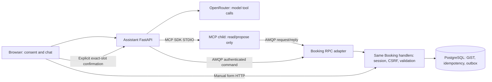

# WB-06 Assistant: protocol and operations

Implementation branch: `feat/wb-06-assistant-mcp`, issue [#22](https://github.com/smalvik/biocad-workspace/issues/22).
This document describes source code; current deployment/proof is in CURRENT_STATE and WB-06 change notes.



## RabbitMQ contract

The private durable queue `biocad.booking.rpc.v1` accepts JSON envelopes with
`schema_version=1`, UUID `request_id`, absolute Unix `deadline_at`, allowlisted
`operation`, opaque `session_token`, `csrf`, and operation `payload`. The AMQP
`correlation_id` must equal `request_id`; exclusive auto-delete reply queues begin
`biocad.rpc.reply.`. Requests are persistent, TTL 15 s, queue length 256 with
reject-publish overflow, consumer prefetch 4. Client timeout 12 s; server work at
most 10 s and never after its deadline. Replies carry `type=booking.response.v1`,
schema version, correlation, HTTP-compatible status and sanitized domain data.

Operations: auth, authorize (rate window), reserve_llm (spend reservation),
search_employees, list_spaces, get_availability, get_space_details,
create_booking and replay_booking. Unknown envelope fields/operations are rejected.
Read results exclude contact details and other people's raw reservation/session data.
Only fictional colleague profiles are eligible. Distance is measured on the selected
floor to an assignment/reservation for the selected interval, never physical presence.
Lists explicitly report truncation.

The adapter calls the existing FastAPI handlers through **in-process ASGITransport**,
not backend network HTTP. This preserves one set of auth/CSRF/validation/DB/outbox
rules. Internal quota/replay routes additionally require an ASGI extension set only
by this adapter; an HTTP header cannot grant access. Booking remains ready based
on PostgreSQL alone and retries its broker connection in the background. A reply
timeout never authorizes repeating a write with a new idempotency key.

## MCP and LLM boundary

The official pinned `mcp==2.3.0` SDK starts `python -m app.mcp_server` as a real STDIO
subprocess. The SDK client negotiates MCP, discovers schemas, calls tools and reads
typed structured results. No in-process substitute is used in the runtime path.
The child gets only an environment allowlist: Python path/runtime, RabbitMQ URL,
opaque user session, user ID and proposal signing key. It never gets the provider key.

Four required read tools plus `propose_booking` and `ask_clarification` are exposed.
There is **no booking write/cancel tool**. A proposal rechecks real availability,
rejects dedicated/busy/unknown resources, validates aware UTC timestamps and a
future interval within one Moscow calendar day, then signs the exact selection
and owner for 10 minutes. Browser confirmation submits that opaque token and a
stable idempotency key; Booking authenticates and commits using existing rules.
Expired tokens permit only recovery of the same already committed confirmation,
for up to 8 hours, never a new write. Cross-day AI requests ask for one day in this
demo; the independent Booking API remains unchanged.

WB-11 planning fix: when `get_availability` returns nonempty server-filtered/ranked
candidates, the controller calls MCP `propose_booking` for the first candidate and
the canonical returned period immediately. That second read rechecks availability
and signs a proposal; it does not write a booking. This finishes within the same
planning round instead of spending another LLM round after availability, including
at the 4-round boundary. Tool count remains bounded at 8. Temperature 0 and explicit
name-fragment/clarification instructions reduce redundant model searches.

The OpenRouter key is server-only. The model receives consented user text,
fictional tool data and floor/time context, with at most 6 history messages,
1500 characters per message, 24000 serialized input UTF-8 bytes, 768 output tokens,
4 provider rounds, 8 tool calls and 60 seconds per chat. Two active chats per
Assistant process are allowed. Tool names come from discovery; user-supplied
system/tool history is rejected. Free-form model claims are not confirmation UI:
the server builds proposal/clarification text from actual typed tool results.
Model/provider failure returns an honest error and leaves the manual form usable.

Production uses only `https://openrouter.ai/api/v1`, no redirects/arbitrary base URLs.
Provider routing requires tool parameters, disables provider fallback, denies data
collection and caps prompt/completion/request pricing at **0**. Only explicit
`:free` variants are allowed; each chat verifies current official catalog prices
and required tool capabilities. A price change or catalog failure stops AI instead
of routing to a paid endpoint. One same-model 429 retry waits at least Retry-After
(3–10 s). Without an eligible verified fallback, longer/invalid delays or a repeated
429 return an honest rate error; WB-12 may instead make its one bounded switch.
WB-12 adds one request-local switch to a separately verified named free model after
eligible availability failures. The shared limit is six inference HTTP attempts,
four planning rounds, eight tools and 60 seconds including fresh catalog checks.
Auth/billing/policy and price/model boundary failures terminate; they do not switch.
See [ADR-003](../adr/003-free-model-failover.md) for routing and validation details.

## Configuration and spend cap

Set server-only `OPENROUTER_API_KEY`, approved `OPENROUTER_PRIMARY_MODEL`, a separate
random `ASSISTANT_PROPOSAL_SECRET` (32+ characters outside local), and an approved
`ASSISTANT_BUDGET_USD=0`. The user explicitly approved **free models only**.
The selected primary is `inclusionai/ling-3.2-flash:free`; optional
`OPENROUTER_FALLBACK_MODEL=google/gemma-4-26b-a4b-it:free` enables the named
free backup. An empty fallback disables switching. No paid fallback is allowed.
`ASSISTANT_REQUESTS_PER_MINUTE` defaults to 3 per authenticated employee, persisted
in PostgreSQL. Free inference works with a zero monetary budget. Runtime Compose
enforces `ASSISTANT_FREE_ONLY=true`; Booking rejects paid reservation requests.

The additive migration retains a conservative monetary-reservation ledger and
synthetic concurrency tests, but the approved free runtime does not spend from it.
Paid mode is not enabled by this delivery. Provider account/free rate limits remain
independent constraints and may make AI temporarily unavailable; the manual form
continues to work. API proof records actual model/provider and returned zero-cost
usage metadata without credentials or raw prompts.

Bootstrap adds a proposal secret to BIOCAD environment secrets while retaining
existing DB/session/broker secrets. No LLM key or spending allowance is inferred
from the existence of credentials. Secrets are never committed or sent to a model.

## Regression versus live proof

`python scripts/check.py --run-type regression` uses a disposable Compose project,
real PostgreSQL/RabbitMQ/STDIO MCP and a **scripted HTTP LLM fixture** from the
existing assistant-tests image. It makes no real inference calls and marks this
in run.json and API/test metadata. The fixture exists only in the test profile,
requires APP_ENV=local, explicit fixture flag, exact local URL/test model/test key,
and is rejected in staging/production. It is never advertised as a real LLM answer.

Live proof is a separate opt-in check against the approved real model and budget,
using fictional users/requests and recording model/tool names, exact selection,
status and cost metadata without API keys, cookies, CSRF or signed proposal tokens.
Published Allure reports must distinguish deterministic regression from live proof.

The proposal-only live acceptance command is:

```powershell
python scripts/check_live_assistant.py --base-url http://localhost:8080 --expected-model inclusionai/ling-3.2-flash:free --allow-free-live
```

Run it only after approval and configuring the real local Assistant. It logs in as
fictional e12, tests room capacity / near-Anna / clarification, verifies exact time
and unchanged own bookings, writes sanitized run.json plus `live_llm` Allure results,
then logs out. It never calls booking confirmation/cancellation. Without `--allow-free-live`
it exits before network requests. `--expected-sha` optionally pins the deployed source.
Real local run `20261115T131327Z-20b777` passed 3 cases with 8 successful provider
responses, all `cost=0`; the stack used a dirty pre-commit snapshot, recorded separately.

Primary references: [MCP Python SDK client](https://py.sdk.modelcontextprotocol.io/client/),
[MCP Python SDK](https://github.com/modelcontextprotocol/python-sdk),
[aio-pika RPC](https://docs.aio-pika.com/rabbitmq-tutorial/6-rpc.html),
[OpenRouter tool calling](https://openrouter.ai/docs/guides/features/tool-calling),
[provider pricing/routing](https://openrouter.ai/docs/guides/routing/provider-selection).
