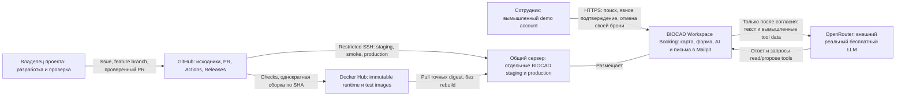

# C1 — контекст реализованной системы

Срез кода WB-10, база продукта — опубликованный v1.4.1. Контекст включает людей и
внешние системы; Compose-контейнеры и внутренние протоколы раскрыты в [C2](C2.md).

Сотрудник использует русскоязычное приложение, резервируя ресурс/время, а не отмечая
физическое присутствие. AI не подтверждает бронь. Только Booking Service с PostgreSQL
решают, можно ли сохранить запись; пользователь отдельно подтверждает точный вариант.
Ручная форма не зависит от доступности модели, MCP или брокера.

OpenRouter — единственная внешняя runtime-интеграция AI; модель free-only,
бюджет $0, каталог и price caps проверяются каждый чат/запрос. Ключи/сессии не передаются
модели. Проверенная live-интеграция не означает гарантии доступности бесплатного провайдера.
Mailpit находится **внутри системы**, а внешнего SMTP/реальной корпоративной почты нет.
GitHub/Docker Hub относятся к delivery, не к пользовательскому запросу бронирования.

Демо-аккаунты вымышленные; корпоративные SSO, HR и календари не интегрированы.
Существующий общий Traefik маршрутизирует HTTPS, чужие приложения за границами BIOCAD.
Только собственный Web соединён с общей ingress-сетью; инфраструктура не HA.

Код/проверки: [React](../../apps/web/src/App.tsx),
[Booking](../../services/booking/app/main.py),
[Assistant](../../services/assistant/app/main.py),
[Worker](../../services/notification/app/main.py),
[Actions](../../.github/workflows/ci.yaml), [deploy isolation](../process/DELIVERY.md).
[Опубликованное evidence](../evidence/WB-08-remote.md), [сценарии приёмки](EVIDENCE.md).
