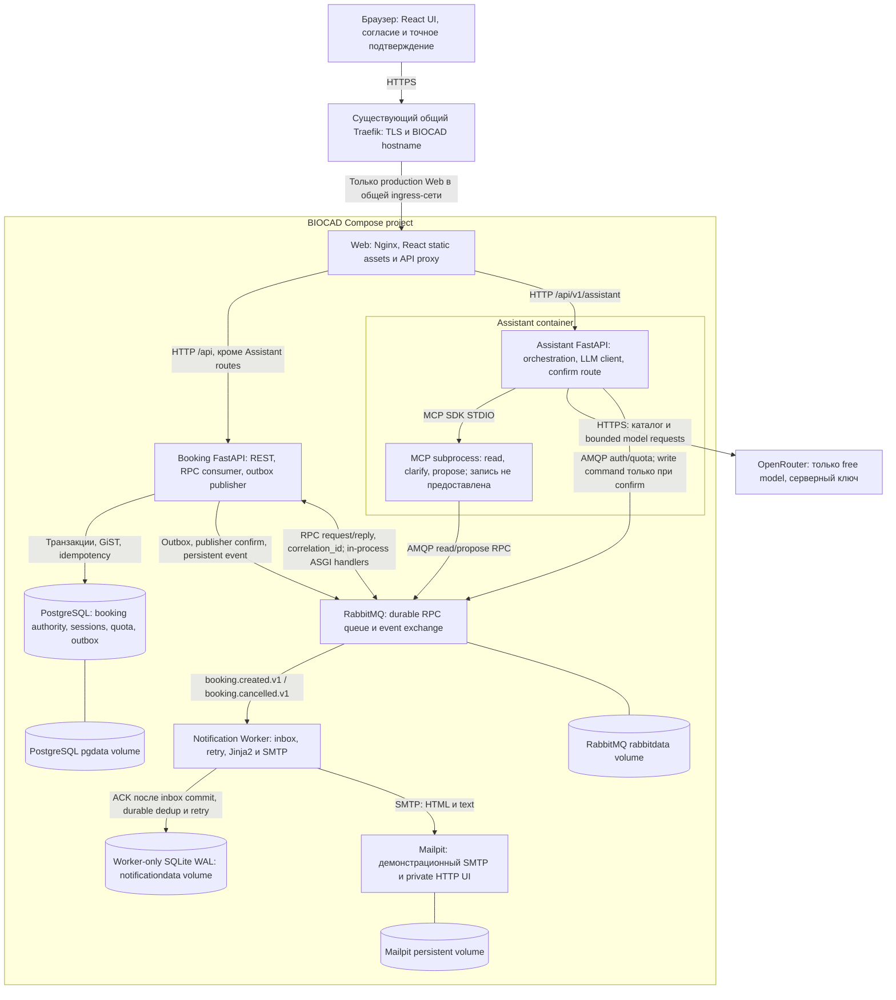

# C2 — контейнеры, протоколы и владение данными

Это текущая реализация, включая WB-06/07/08 и deadlock fix v1.4.1.
Схема показывает одну persistent среду; staging и production имеют отдельные
сети, учётные данные и volumes. [C1: внешний контекст](C1.md).

| Контейнер | Ответственность и данные | Исходник/контракт |
|---|---|---|
| Web | Static React, Nginx API proxy, browser-only confirmation/retry state | [nginx.conf](../../apps/web/nginx.conf), [BookingFlow](../../apps/web/src/BookingFlow.tsx) |
| Booking | Единственный владелец PostgreSQL; REST и RPC вызывают одинаковые auth/CSRF/domain handlers; outbox атомарен с бронью | [bookings.py](../../services/booking/app/bookings.py), [models](../../services/booking/app/models.py), [RPC adapter](../../services/booking/app/rpc.py), [outbox](../../services/booking/app/outbox.py) |
| Assistant | Независимый FastAPI без Booking DB; bounded LLM loop; подписанное user-bound предложение; подтверждение пересылает Booking-команду | [agent](../../services/assistant/app/agent.py), [confirm](../../services/assistant/app/main.py), [proposals](../../services/assistant/app/proposals.py) |
| MCP child | Реальный STDIO subprocess внутри Assistant image, не отдельный deployment; не получает OpenRouter key; read/propose only | [mcp_server](../../services/assistant/app/mcp_server.py), [подробный envelope](ASSISTANT.md) |
| RabbitMQ | Durable `biocad.booking.rpc.v1`, temporary reply queues; topic `biocad.booking.events.v1`, notification/invalid queues | [RPC client](../../services/assistant/app/rpc.py), [event contract](../../services/notification/app/events.py) |
| Notification | Отдельный Python process/image, приватная SQLite WAL; нет доступа к Booking DB; retry/dedup завершённых событий | [main](../../services/notification/app/main.py), [store](../../services/notification/app/store.py), [templates](../../services/notification/app/templates/booking.html) |
| Mailpit | Только demo SMTP; persistent capture, доступ локально через loopback, на сервере private | [local Compose](../../infra/compose.yaml), [release Compose](../../infra/compose.release.yaml) |

Реальный RPC envelope использует `schema_version`, UUID request/correlation ID,
deadline, allowlisted operation, session/CSRF и payload. Это единая очередь с operation
allowlist, а не отдельные speculative `.availability.request` очереди из раннего PRD.
RPC adapter использует **in-process ASGITransport**, сетевого HTTP Assistant → Booking нет.
Только отдельный user-confirm endpoint отправляет `create_booking`; у LLM/MCP write tool нет.
После commit reply может потеряться: повтор использует тот же idempotency key, не новую бронь.

POST Booking не вызывает брокер/SMTP в своей транзакции. Publisher повторяет неопределённый
publish с тем же event ID; Worker ACK после сохранения в inbox. SMTP и inbox commit
не атомарны, поэтому crash после SMTP acceptance допускает повтор письма.
SQLite inbox выбран для одного Worker; независимые Worker на разных хостах требуют
другого общего transactional store. [ADR-001](../adr/001-booking-consistency.md),
[ADR-002](../adr/002-broker-and-outbox.md).

Local Compose публикует loopback development ports. Persistent серверные проекты
публикуют Web только на loopback 18081/18080; в общей Traefik сети только production Web.
Assistant/Worker не получают администраторские/CI/registry credentials; Worker также
не получает session/LLM/DB credentials. Data networks логически изолируют проекты,
но не являются отдельными ACL на каждую пару контейнеров. См. [delivery runbook](../process/DELIVERY.md).

Healthchecks не подменяют приёмку: Booking readyz проверяет PostgreSQL; Assistant
healthz — процесс, Worker — heartbeat/storage. Живые RPC/SMTP и отказоустойчивость
проверяются отдельными [реальными integration/E2E](EVIDENCE.md).
Race mutation probe находится только в Booking test image и не входит в эту runtime-схему.
