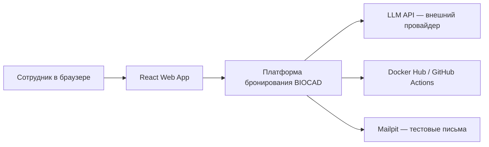
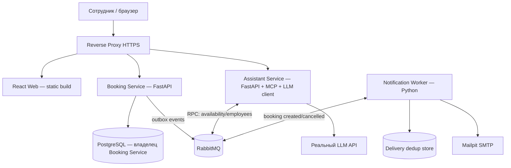
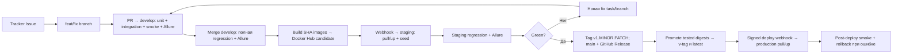

# PRD · BIOCAD Workspace Booking Platform

**Версия:** 1.1 — Personal Comfort & AI Fallback  
**Дата:** 13.11.2026  
**Статус:** проект требований к реализации тестового задания  
**Технологии:** React, Python/FastAPI, PostgreSQL, RabbitMQ, MCP, LLM API, Docker, GitHub Actions, Allure  
**Срок:** 3 календарных дня с согласованной даты начала  
**Цель:** работающий публично доступный MVP и доказуемый enterprise-подход к разработке и выпуску релизов.

> **Важно о текущем состоянии.** Ранее созданы статические макеты и демонстрационный HTML-прототип карты сотрудников. Они **не заменяют** работающие backend, LLM/MCP, хранение броней, тесты, CI/CD и публичный деплой. Публично доступный официальный BIOCAD UI Kit не подтверждён; до его предоставления используются приближённые бренд-токены, которые легко заменить.

## 1. Продукт, пользователи, результат

**Проблема.** Сотрудник не видит на одном плане, где находятся коллеги, какие рабочие места постоянно закреплены, какие FreeDesk заняты на определённый период и какие переговорные свободны. Ручное бронирование создаёт коллизии.

**Решение.** Веб-приложение на русском языке с интерактивными планами, поиском сотрудников и двумя способами бронирования: формой и AI-чатом. Источник истины — PostgreSQL и Booking Service; LLM лишь помогает найти вариант и сформировать предложение, но не определяет факт бронирования.

**Роли:** сотрудник (поиск, бронирование, отмена своей брони), демонстрационный администратор (только заполнение тестовыми данными/технический доступ, без полноценного кабинета).

**Обязательный результат при сдаче:** GitHub-репозиторий, ссылка на развёрнутое приложение с работающими формой и реальным AI-чатом, Docker Hub образы, Allure-отчёты smoke/regression, история веток и релиза, README, C1/C2, 2 ADR, AI-LOG.md, доказательство теста с намеренно отключённой защитой от коллизий.

### 1.1 Приоритеты

- **P0 — безусловно для сдачи:** план этажа; выбор этажа/даты/интервала; рабочие места и переговорные; различимые статусы; поиск сотрудников и правая панель; реальная форма создания/отмены; PostgreSQL с конкурентной защитой и идемпотентностью; AI через MCP и реальный LLM API; отказоустойчивость при сбое AI; RabbitMQ между сервисами; автотесты и Allure; Docker/CI/CD/deploy; README, ADR, AI-LOG.
- **P1 — после готового P0:** подбор по ограничениям комфорта (этаж, окно, HVAC, шум и т. п.), добровольный стартовый квиз, переключение LLM-модели при сбое, расширенный фильтр сотрудников. Для 3-дневного демо реализовать узкий вертикальный сценарий на моковых атрибутах и реальном механизме поиска.
- **P2 — при остатке времени:** запрос отзыва после завершённой брони, сохранение предпочтений, рекомендация ранее понравившегося места и причинный подбор альтернатив; расширенная аналитика, маршрут до места и серверные пуш-обновления.
- **Не входит в MVP:** настоящий корпоративный SSO, интеграция с HR/календарями, импорт CAD/BIM, администрирование этажей через GUI, мобильное приложение, работающий production SMTP за пределами Mailpit, Kubernetes, высокодоступный кластер.

## 2. Что было и чего не хватало в первоначальном ТЗ

| Блок требований | Визуальная проработка ранее | Требование к релизу |
|---|---|---|
| Этажи, зоны, проходы, выбор времени, zoom, легенда, карточки | Макеты / HTML-демо | Реактивный React с актуальным API |
| Поиск сотрудников, фото, ФИО, должность, постоянное/FreeDesk | Моковые сценарии | Данные из API, подсветка на карте, корректная правая панель |
| Выбор и бронирование места/переговорной | Экранные сценарии | Транзакционное создание на сервере |
| Отмена собственной брони и обновление занятости | Макеты | Авторизация, отмена, актуализация состояния |
| Запрет пересечений, смежные интервалы, параллельные запросы | Не реализовано | Ограничение на уровне БД + интеграционные тесты |
| Повтор подтверждения и валидация | Не реализовано | Idempotency-Key и проверки 4xx |
| Сохранность после рестарта | Не реализовано | Persistent volumes + PostgreSQL |
| Реальный LLM + MCP | Только интерфейс | Рабочая интеграция и проверка актуальных данных |
| Ошибки AI, пустые состояния, загрузка | Макеты | Обработчики и проверенные E2E-сценарии |
| Два+ микросервиса, брокер | Не реализовано | Независимые контейнеры и RabbitMQ |
| GitHub, релизы, staging/prod, Docker Hub, Allure | Не реализовано | Действующий CI/CD с артефактами |
| README, C1/C2, ADR, AI-LOG, демонстрация дефектного теста | Не реализовано | Файлы и ссылки в репозитории |

## 3. Пользовательские сценарии и критерии приёмки

### US-01. Поиск места на карте (P0)

Сотрудник выбирает офис, этаж, дату и интервал времени. План показывает рабочие места, переговорные, двери, проходы и зоны (кухня, санузлы, зона отдыха), умеет масштабироваться (+/−/fit), отображает легенду и время последнего обновления. Все времена показываются с пометкой **МСК**.

**Приёмка:** минимум 2 демонстрационных этажа (один детальный); минимум 24 рабочих места и 3 переговорные на основном плане; динамический пересчёт при изменении даты/времени; подсветка выбранного объекта; кликабельность клавиатурой; загрузка, пустой результат и ошибка API отрисовываются явно.

### US-02. Поиск сотрудников (P0)

Сотрудник ищет по ФИО или части ФИО, видит моковую аватарку, должность, отдел и этаж. По клику на результат выбранное место подсвечивается на плане, автоматически выбирается нужный этаж и открывается сайд-панель. Для сотрудника на FreeDesk местоположение определяется **только при пересечении его активной брони с выбранным интервалом**. Для постоянного сотрудника — по действующему постоянному закреплению.

**Приёмка:** поиск без учёта регистра; пустая выдача; выбор из результатов; не менее 12 вымышленных сотрудников; ни одна моковая фотография не должна выдавать себя за реального работника BIOCAD.

### US-03. Статусы мест и правая панель (P0)

| Статус на карте | Определение | Что видно в панели | Действие |
|---|---|---|---|
| Постоянно закреплено | `DEDICATED` с действующим назначением | Аватар, ФИО, должность, отдел, «закреплено постоянно», начало назначения (если известно) | Бронирование запрещено |
| FreeDesk свободен | Нет конфликтующей активной брони на выбранный интервал | ID, этаж/зона, оборудование, «свободно», выбранная дата и время, ближайшая следующая бронь (если существует) | «Забронировать» |
| FreeDesk занят | Есть пересекающаяся бронь другого сотрудника | Кто занял, аватар, должность, **дата начала/конца и время начала/конца (МСК)**, тип FreeDesk | «Другое время/место» |
| Моя бронь | Активная бронь выбранного пользователя | Моя бронь, даты, время, ID брони | «Отменить» |
| Переговорная свободна/занята | Те же временные правила, но тип `MEETING_ROOM` | Название, вместимость, оборудование, период брони | Бронировать / подобрать альтернативу |
| Выбрано | UI-состояние независимо от статуса занятости | Контекстная карточка без изменения серверного статуса | Подходящее действие |

**Отдельное правило:** если FreeDesk занят 09:00–12:00, период 12:00–13:00 доступен; если бронь начинается в 14:00, время 12:00–14:00 доступно. Постоянное место не становится FreeDesk, даже если владелец отсутствует.

### US-04. Бронирование через форму (P0)

Пользователь нажимает свободное место или переговорную, видит ID, расположение, дату, начало и конец, нажимает «Продолжить», затем **явно подтверждает**. До подтверждения сохранения нет. Backend ещё раз проверяет правила и возвращает подтверждённую бронь.

**Приёмка:** `201 Created`; повтор с тем же ключом и payload возвращает ту же бронь (`200 OK`); другой payload с тем же ключом — `409 Conflict`; пересечение — `409`; недопустимые значения — `422`; повторы при потере сети не создают копий.

### US-05. Бронирование через AI (P0)

Пользователь пишет: «Найди переговорную на 6 человек на 16 ноября с 14 до 15» либо «Найди FreeDesk рядом с Анной Смирновой». AI использует реальный LLM API и MCP-инструменты, которые получают **живые данные** Booking Service через RabbitMQ RPC. Предложение подсвечивается на плане и появляется в карточке. **Запись происходит только после однозначного подтверждения** кнопкой или фразой в чате («Да, бронируй»); действие проходит через те же серверные правила, что и форма.

**Приёмка:** доступны MCP-инструменты `search_employees`, `list_spaces`, `get_availability`, `get_space_details`; некорректный/галлюцинированный `space_id` не может создать бронь; сбой LLM/MCP оставляет обычную форму работоспособной; подтверждение не переносится молча на другой слот.

### US-06. Мои брони, отмена, уведомления (P0)

Пользователь видит активные/отменённые брони, отменяет **только свою** бронь с подтверждением. После отмены занятость обновляется, а событие попадает в очередь. Notification Worker отправляет письмо через локальный SMTP Mailpit: «Бронь подтверждена» или «Бронь отменена».

**Приёмка:** чужая отмена — `403`; собственная отмена идемпотентна; письмо содержит тип объекта, адрес офиса/этаж, начало и конец (МСК), код брони и CTA; письмо приходит в Mailpit и проверяется интеграционным тестом; отказ SMTP не откатывает бронь.

### US-07. Устойчивость и состояния UI (P0)

Проверяются skeleton при загрузке, пустая выдача, ошибка загрузки этажа, API timeout, конфликт брони, недоступный AI, успешное создание/отмена и обновление занятости. Для обновления на MVP достаточно polling раз в 15–30 секунд, ручной кнопки «Обновить» и немедленного refetch после мутаций; финальную проверку перед созданием выполняет сервер.

## 4. Домен, данные и бизнес-инварианты

**Сущности:** `Employee(id, full_name, job_title, department, avatar_url, email)`; `Office`; `Floor`; `Space(id, floor_id, kind: DESK|MEETING_ROOM, desk_mode: DEDICATED|FREEDESK|null, capacity, polygon/coordinates, equipment)`; `PermanentAssignment(employee_id, space_id, valid_from, valid_to)`; `Booking(id, employee_id, space_id, start_at, end_at, status, idempotency_key)`; `OutboxEvent(id, aggregate_id, type, payload, published_at)`; `NotificationDelivery(event_id, channel, status)`.

1. Все даты хранить в PostgreSQL как UTC (`timestamptz`), отображать в `Europe/Moscow`; API принимает ISO 8601 с явным offset. `start_at < end_at`; диапазоны полуоткрытые `[start_at, end_at)`.
2. На одном `space_id` не может быть двух **активных** пересекающихся бронирований. База реализует `EXCLUDE USING gist (space_id WITH =, tstzrange(start_at, end_at, '[)') WITH &&) WHERE (status = 'confirmed')` с расширением `btree_gist`. Это защищает также от параллельных запросов разных процессов. См. документацию PostgreSQL: https://www.postgresql.org/docs/current/rangetypes.html.
3. Постоянные места (`DEDICATED`) нельзя бронировать через пользовательский endpoint; постоянные назначения не должны конфликтовать друг с другом и действуют независимо от бронирований.
4. `UNIQUE(employee_id, idempotency_key)` или отдельная таблица идемпотентных операций хранит хеш запроса и результат. Ключ с тем же payload возвращает исходный ответ, даже если бронь уже отменена; ключ с другим payload отвергается. Ключ подтверждения уникален для логической операции и повторно используется при сетевых ретраях.
5. Проверка существования объекта, типа, полномочий, периода, лимитов и отсутствие конфликтов проводится **сервером**. Не доверять датам, `employee_id` и статусу из браузера или LLM.
6. Бронирование и outbox-event сохраняются **в одной транзакции**. RabbitMQ доставляет событие как минимум один раз, Worker дедуплицирует его по `event_id`; потеря брокера не приводит к потере факта бронирования.
7. Возвращать корректные HTTP-коды и машиночитаемые ошибки (`BOOKING_CONFLICT`, `SPACE_DEDICATED`, `VALIDATION_ERROR`, `AI_UNAVAILABLE`), без утечки секретов и PII в логи.
8. Для демо без SSO — несколько тестовых аккаунтов и подписанные сервером сессии; нельзя произвольно подменять ID владельца брони. Реальная корпоративная авторизация — за пределами MVP.

## 5. Архитектура C1 / C2

### C1. Контекст



### C2. Контейнеры и владение данными



**Сервис 1 — Booking Service:** владеет офисами, этажами, планами, сотрудниками, местами, постоянными назначениями и бронями; REST API для браузера; обработчик RPC-запросов из RabbitMQ; PostgreSQL и Alembic. **Только этот сервис** может создавать/отменять бронь.

**Сервис 2 — Assistant Service:** независимый FastAPI с MCP-сервером и реальным LLM API; вызывает инструменты доступности/поиска через RPC в RabbitMQ, не читает Booking DB напрямую. На явное подтверждение пользователя посылает команду Booking Service через RPC с `request_id` и idempotency key; сервер бронирований выполняет общие правила. Таймаут брокера или LLM — понятная ошибка только для чата.

**Сервис 3 — Notification Worker:** отдельный Python-процесс/контейнер, читает события созданной и отменённой брони, формирует Jinja2 HTML-письма в стиле BIOCAD, отправляет SMTP в Mailpit и дедуплицирует доставки.

**Инфраструктура:** PostgreSQL, RabbitMQ с durable queues/persistent messages, Mailpit на staging, reverse proxy Caddy/Nginx, Docker Compose. Физически может быть один экземпляр PostgreSQL, но данные сервисов логически разделены: Booking не предоставляет прямой доступ к таблицам Notification; для dedup worker допустим отдельный schema/таблица. На продакшене почтовый канал остаётся тестовым в рамках задания.

**Важная граница:** HTTP от браузера к API нужен для интерактивности; **взаимодействие между backend-сервисами идёт через RabbitMQ**. Для AI-read используется request/reply с `correlation_id`, reply queue и timeout. Для write — идемпотентная команда, подтверждение результата исключительно после commit БД. RabbitMQ не заменяет PostgreSQL-транзакцию.

### 5.1 Минимальные API / события

| Контракт | Смысл |
|---|---|
| `GET /api/v1/floors`, `GET /api/v1/spaces?floor_id&from&to` | Планы и фактические статусы |
| `GET /api/v1/employees?q=`, `GET /api/v1/employees/{id}/location?from&to` | Поиск сотрудника и его локации |
| `POST /api/v1/bookings` + `Idempotency-Key` | Подтверждённое бронирование |
| `GET /api/v1/bookings/me` | Личный список |
| `POST /api/v1/bookings/{id}/cancel` | Идемпотентная отмена только своей |
| `POST /api/v1/assistant/chat` | Чат, намерения и предложения |
| `GET /healthz`, `GET /readyz` | Проверка процесса и зависимостей |
| `booking.availability.request.v1` / `.response.v1` | RabbitMQ RPC для MCP |
| `booking.create.request.v1` / `.response.v1` | RabbitMQ RPC для подтверждения через чат |
| `booking.created.v1`, `booking.cancelled.v1` | Асинхронные уведомления |

События версионируются, содержат `event_id`, `occurred_at`, `correlation_id`, `booking_id`, `schema_version`. Ненужные персональные данные в очередь не помещаются.

## 6. UI/UX и BIOCAD дизайн-система

**Дизайн-принцип:** одна система компонентов для всех экранов: header, фильтры, интерактивный SVG-план, legend, EmployeeSearch, EmployeeCard, SpaceDrawer, BookingDialog, AIChatDrawer, BookingList, Alert/Toast, EmptyState, Skeleton. На мобильной ширине боковая панель становится drawer.

**Рабочие токены до получения официального UI Kit (не выдавать за официальный брендбук):** `--brand-navy: #0C204D`; `--brand-green: #43B880`; `--surface: #F4F6FB`; `--text: #222224`; скругления 8/12/16 px; типографика — доступный шрифт Arial / совместимый sans-serif. Контраст, фокус-кольца, aria-label для мест, цвет + текст/узор для статусов. Запрещено обозначать занятость одним только цветом. После получения официального BIOCAD UI Kit заменить токены, шрифты и иконки без переписывания компонента карты.

**Моковые данные:** 2 этажа; основной с 24+ местами и 3 переговорными; 12–18 вымышленных сотрудников; минимум 4 постоянных места, 4 FreeDesk с временными бронями и свободные FreeDesk; смежные временные слоты; несколько отделов и типов переговорных. Seed детерминированный (`make seed`), все даты тестовых броней привязаны к фиксированному демо-дню, а не к `today`, чтобы тесты были повторяемы.

## 7. Репозиторий и задача = ветка = PR

**Модель:** GitHub monorepo. `main` — утверждённые релизы, `develop` — интеграционная ветка. Любая задача трекера, включая документацию/исправление, ведётся в **собственной ветке**, открывает **один PR в `develop`**; прямые push в `develop/main` запрещены.

Conventional Commits v1.0.0 стандартизирует **сообщения коммитов**, а не имена веток. Поэтому проект вводит согласованный формат веток, совместимый по типам:

`<type>/<issue-id>-<short-description>` — например, `feat/wb-04-employee-search`, `fix/wb-11-prevent-double-booking`, `ci/wb-09-release-pipeline`, `docs/wb-10-adr-c2`. Типы: `feat`, `fix`, `chore`, `ci`, `test`, `docs`, `refactor`. Коммиты: `feat(map): add employee search`, `fix(booking): prevent overlapping reservations`. Ссылка на тикет — в PR; branch/commit lint — обязательный статус.

**Definition of Done каждой ветки:** есть постановка и AC; unit-тесты для правил; integration-тесты затронутых контрактов с настоящими PostgreSQL/RabbitMQ; E2E при изменениях frontend/пользовательского сценария; каждый PR запускает общий E2E smoke даже для backend/infra-only веток; lint/typecheck/security-baseline; зелёный PR CI; отчёт Allure с `suite=smoke` или `suite=regression`, ссылкой на PR и SHA; code review/самопроверка; нет секретов в git. Если изменение тестировать невозможно на одном из уровней, в PR указывается причина, но общий CI smoke всё равно обязателен.

**Правило интеграции:** после merge в `develop` запускается **полный** набор unit + integration + E2E regression всего репозитория; затем candidate образ по SHA деплоится на staging с seed и выполняется staging regression. Красный прогон запрещает релиз. Зафиксированное на staging состояние (commit SHA и image digests) переводится в релиз.

## 8. Релизная политика и CI/CD

**SemVer:** только `1.MINOR.PATCH` в тестовом задании. Базовая линия `v1.0.0`, следующий функциональный релиз `v1.1.0`, исправление `v1.1.1`. `feat` → MINOR; `fix` → PATCH; если в пакете и feature и bugfix — один MINOR; при breaking change в пределах задания не повышать MAJOR, а документировать несовместимость и согласовать. **Версию получает не отдельная PR-ветка, а проверенный snapshot `develop`/GitHub Release**.

**Workflow:**



**Образы Docker Hub:** `organization/biocad-web`, `organization/biocad-booking`, `organization/biocad-assistant`, `organization/biocad-notifier`. Каждый релизный образ имеет теги `sha-<gitsha>`, `v1.x.y`, `latest` (только после приёмки) и OCI-label с Git SHA. **Нельзя повторно пересобирать** после staging-regression: добавление version/latest — продвижение проверенного digest. Для rollback хранить предыдущий digest/версию; `latest` — удобная ссылка, но для аудита и восстановления записывать digest, который действительно развёрнут.

**Ubuntu 22.04:** на машине Docker/Compose. Изолированные `staging` и `production` compose-проекты, сети, volumes, переменные, порты; backup volume БД перед обновлением. Webhook с HMAC/подписью и проверкой timestamp/события запускает ограниченный `deploy.sh`: `docker compose pull` → `docker compose up -d --no-build` → readiness/smoke. **Сборка image выполняется в GitHub Actions**, не на сервере; «сборка стенда» — подъем Compose из готовых образов. Если webhook недоступен извне, эквивалентом служит CI job по SSH с ограниченными правами, это решение фиксируется в README.

**GitHub Actions jobs:** `branch-policy`, `frontend-lint-test`, `backend-unit`, `integration-postgres-rabbitmq`, `e2e-smoke`, `allure-publish`, `full-regression`, `build-images`, `deploy-staging`, `staging-regression`, `release-promote`, `deploy-prod`, `prod-smoke`. Секреты `DOCKERHUB_TOKEN`, `LLM_API_KEY`, `DEPLOY_WEBHOOK_SECRET` только в GitHub Actions Secrets / environment secrets и в серверном `.env` с ограниченными правами; не в репозитории и не в HTML. Правила approvals зависят от тарифа GitHub и типа репозитория, поэтому при их недоступности фиксируется ручное подтверждение release job.

## 9. Тест-стратегия и Allure

**Инструменты:** pytest + pytest-asyncio/httpx + allure-pytest (backend), React Testing Library/Vitest (frontend unit), Playwright + allure-playwright (E2E), настоящий PostgreSQL и RabbitMQ через Docker Compose/Testcontainers. SQLite **не** подходит для теста конкурентной защиты PostgreSQL.

| Уровень / прогон | Ключевые кейсы | Когда |
|---|---|---|
| Unit | Валидация времени, стык интервалов, статус места, RBAC, сортировка, шаблоны писем, AI intent parsing fallback | Каждый PR |
| Integration | PostgreSQL exclusion, идемпотентность, перезапуск, RPC timeout, durable events/outbox, SMTP Mailpit | Каждый PR; полный на develop |
| E2E smoke | План открылся, найти сотрудника, свободное место, создать бронь, отменить, чат работает, fallback AI | Каждый PR и после deploy |
| E2E regression | Все типы мест, дата/время, zoom, занят/свободен, конфликты, пустая выдача, ошибка AI, письмо | `develop` и staging |
| Concurrency | 20 параллельных запросов к **реальному** серверу и БД на одно место/интервал: 1 × 201, 19 × 409; смежные интервалы оба успешны | Blocking regression |
| Mutation demonstration | В изолированной тестовой БД временно снять exclusion constraint, гарантированно спровоцировать конкурентное сохранение через синхронизированные запросы; тест становится красным; восстановить защиту — зелёным | Один зафиксированный доказательный прогон |

**Allure:** отчёт для каждого PR и каждого develop/staging/prod прогона с label `run_type=smoke|regression`, `environment`, `git_sha`, `release_version`; прикладывать HTTP request IDs, скриншоты и Playwright trace на ошибках (без токенов). Хранить `allure-results` как GitHub Actions artifact, публиковать человекочитаемый Allure Report (например GitHub Pages с безопасными демоданными) и ссылки в README/PR. Отдельные папки/история запусков, чтобы отчёт нового прогона не подменял старый.

**Доказательство дефекта:** `docs/evidence/concurrency-red.md` — команда, SHA экспериментальной тестовой версии, фактический FAIL/лог и комментарий «constraint временно выключен, не для выпуска»; `docs/evidence/concurrency-green.md` — команда, SHA исправной версии, PASS. Сдаётся только исправный код. Нельзя выдавать запланированный или искусственно написанный результат за реально выполненный прогон.

## 10. Уведомления и письма BIOCAD

**Mailpit** на staging/демо: SMTP `mailpit:1025`, web UI `:8025` (за паролем/внутренним доступом). Шаблоны Jinja2 для двух событий — создание и отмена. Дизайн: белый фон, тёмно-синий заголовок, зелёная CTA-кнопка, логотип BIOCAD (только разрешённый к использованию ассет), карточка места, дата, интервал **МСК**, этаж и контакты помощи. Текстовая альтернатива обязательна. Тест проверяет появление письма в Mailpit API, `booking_id`, ФИО, дату, правильную тему и отсутствие дубликатов при повторной доставке события.

## 11. Трекер: 1 задача = 1 ветка = 1 PR

Каждой задаче присвоены Priority, Story, Acceptance Criteria, branch, tests, ссылки на PR/Allure. Ниже предполагаемое разделение; задачи сохраняют трассировку до исходного ТЗ.

| ID / приоритет | Задача и ветка | Проверка готовности | Окно |
|---|---|---|---|
| WB-01 P0 | Репозиторий, Compose, CI skeleton — `chore/wb-01-bootstrap` | Сервисы стартуют, health, sample unit/integration/E2E smoke + Allure | День 1 |
| WB-02 P0 | Booking Service, БД, concurrency, idempotency — `feat/wb-02-booking-core` | Race/adjacency/validation/restart tests на реальном Postgres | День 1 |
| WB-03 P0 | Планы этажей, зоны, статусы — `feat/wb-03-interactive-map` | React unit и Playwright zoom/status E2E | День 1–2 |
| WB-04 P0 | Поиск сотрудников и типы мест — `feat/wb-04-employee-locations` | Permanent vs FreeDesk; поиск; правый drawer E2E | День 2 |
| WB-05 P0 | Форма, мои брони и отмена — `feat/wb-05-booking-flow` | Форма↔API; дубли; отказ; отмена; E2E | День 2 |
| WB-06 P0 | Assistant, real LLM, MCP и RabbitMQ RPC — `feat/wb-06-assistant-mcp` | Реальный чат, подсветка предложения, подтверждение, AI-fallback | День 2 |
| WB-07 P0 | События и Mailpit — `feat/wb-07-email-notifications` | Outbox, broker, SMTP шаблоны, dedup integration | День 2 |
| WB-08 P0 | Полный CI, Allure, red/green race evidence — `test/wb-08-regression-evidence` | Все прогоны, ссылки, доказательство дефектного теста | День 3 |
| WB-09 P0 | Staging/prod, Docker Hub, release webhook — `ci/wb-09-release-deploy` | Immutable images, staging regression, prod smoke, rollback script | День 3 |
| WB-10 P0 | README, C1/C2, ADR, AI-LOG, итоговые ссылки — `docs/wb-10-delivery-evidence` | Репозиторий полностью воспроизводим, зафиксированы часы/долги | День 3 |
| WB-11 по факту | Исправление найденного дефекта — `fix/wb-11-<slug>` | Regression green, PATCH-релиз при необходимости | По факту |
| WB-12 P1 | Резервная LLM через OpenRouter — `feat/wb-12-llm-failover` | Основная→резервная→форма без AI; статусы и Allure | День 3 при наличии времени |
| WB-13 P1 | Подбор места по условиям — `feat/wb-13-comfort-search` | Строгие фильтры + объяснимый ranking + карта; unit/integration/E2E | День 3 после P0 |
| WB-14 P1 | Квиз комфорта — `feat/wb-14-comfort-quiz` | Добровольный квиз, профиль и рекомендация с подтверждением; unit/integration/E2E | День 3 после WB-13 |
| WB-15 P2 | Отзывы и повторная бронь — `feat/wb-15-comfort-feedback` | Отзыв после визита, любимое место, fallback альтернатив; unit/integration/E2E | Если останется время |

**Зависимости:** WB-01 → WB-02 → WB-03/04/05; WB-01/02 → WB-06/07; WB-08/09/10 идут итеративно с первого дня, а не полностью откладываются на третий. При нехватке времени не строить P1, но обязательно довести P0 по исходному тестовому заданию.

## 12. План по трём календарным дням

**День 1 — надёжная основа:** GitHub, базовый CI/Allure, Docker Compose, PostgreSQL/RabbitMQ, миграции, deterministic seed, Booking API, конкурентные тесты, первичный SVG-план. В конце дня уже должна создаваться бронь через API и переживать рестарт.

**День 2 — работающий пользовательский поток:** React-план с поиском/правой панелью, форма/отмена, AI-чат с реальным LLM/MCP, RabbitMQ RPC, события, Mailpit, состояния ошибок; обязательные smoke.

**День 3 — доказательства и релиз:** полная регрессия, negative concurrency experiment, Allure, staging/production, version/latest images, release, C1/C2, ADR, README, AI-LOG и финальный E2E smoke по публичной ссылке.

**Stop-rule:** если AI не готов, нельзя сдавать муляж чата как рабочий; упрощать промпт/набор MCP tools, но сохранять реальный LLM и fallback. Если staging/prod не готовы, сначала обеспечить хотя бы **одно** публичное живое окружение с формой и чатом, прозрачным README о долгах. Не сокращать целостность бронирований и concurrent tests.

## 13. ADR

### ADR-001. PostgreSQL exclusion constraint вместо проверки «сначала SELECT, потом INSERT»

**Проблема:** два пользователя одновременно видят FreeDesk свободным и оба создают бронь. **Решение:** `tstzrange` полуоткрытых интервалов и `EXCLUDE USING gist` на `space_id` для активных броней; операция внутри транзакции и idempotency. **Альтернатива:** application lock/Redis mutex/SELECT FOR UPDATE. **Последствия:** строгая гарантия на уровне хранилища и простые race-тесты; решение привязано к PostgreSQL, схему надо мигрировать и протестировать.

### ADR-002. RabbitMQ для взаимодействия backend-сервисов + outbox

**Проблема:** независимые сервисы должны обмениваться событиями и живыми запросами, а падение AI/почты не должно влиять на транзакционную бронь. **Решение:** RabbitMQ RPC для Assistant↔Booking, event queue и transactional outbox для уведомлений, ограниченные таймауты/ретраи/дедупликация. **Альтернатива:** синхронный REST между всеми микросервисами либо общая БД. **Последствия:** соответствует требованию брокера и изолирует сбои; усложняет debugging и требует correlation IDs. Источником истины остаётся Booking DB, а не очередь/LLM.

## 14. Структура репозитория

```text
biocad-workspace/
├── apps/web/                         # React/Vite, UI и e2e
├── services/booking/                 # FastAPI, миграции, booking domain
├── services/assistant/               # FastAPI, MCP, LLM, RabbitMQ RPC
├── services/notifier/                # RabbitMQ consumer, email templates
├── packages/contracts/               # OpenAPI / JSON schemas / types
├── infra/compose.yaml
├── infra/compose.staging.yaml
├── infra/compose.production.yaml
├── infra/nginx-or-caddy/
├── infra/scripts/deploy.sh
├── .github/workflows/pr.yml
├── .github/workflows/develop.yml
├── .github/workflows/release.yml
├── tests/integration/
├── tests/e2e/
├── docs/architecture/C1.md
├── docs/architecture/C2.md
├── docs/adr/001-booking-consistency.md
├── docs/adr/002-broker-and-outbox.md
├── docs/evidence/concurrency-red.md
├── docs/evidence/concurrency-green.md
├── docs/prd.md
├── AI-LOG.md
├── README.md
└── .env.example                     # только имена переменных
```

## 15. Release / Definition of Ready

Релиз принимается, если: 1) оба метода бронирования реально создают записи, без дубликатов; 2) тест конкурентности с настоящим хранилищем стабильно подтверждает единственного победителя; 3) поиск сотрудника и правая панель различают постоянное место, свободный и занятый FreeDesk с конкретными датами/часами; 4) AI использует MCP и актуальные данные, не создаёт бронь без подтверждения и не блокирует форму при сбое; 5) события идут через RabbitMQ, письмо есть в Mailpit; 6) CI полный, Allure smoke и regression опубликованы; 7) staging регрессия зелёная; 8) Docker Hub содержит version и latest, production доступен; 9) указаны GitHub/live URL, changelog/release, README, 2 ADR, C1/C2, AI-LOG, реальные команды и результаты тестов; 10) все секреты вне git.

## 16. Документы сдачи и работа с ИИ

**README:** запуск одной командой, варианты local/staging/prod, env-переменные без значений, миграции и seed, настройка LLM, API/контракты, тестовые пользователи, smoke/regression команды, Allure URLs, Docker Hub links, рабочая ссылка, CI/CD, recovery/rollback, допущения, критерии «готово», что отложено, фактически потраченные часы и чему научились.

**AI-LOG.md, до одной страницы:** что сделал разработчик и что поручалось агенту; 2–3 конкретных решения (инициатор, принятие/изменение, проверка, код/тест); разногласия; ссылки на issue/commit/PR; агент подготавливает, человек проверяет. Не выдумывать использованные модели, действия, результаты и затраченное время.

**C1/C2 и ADR:** хранятся и в README кратко упоминаются. **Evidence:** terminal logs, CI run IDs, report URLs, screenshot UI, red/green concurrency experiment, RabbitMQ/Mailpit verification. **Демо:** продемонстрировать отсутствие двойной брони двумя конкурентными клиентами и отказоустойчивость при отключении Assistant Service.

## 17. Риски, допущения, безопасность

- **Риск срока:** брокер RPC + MCP + настоящий LLM + CI/CD — наиболее сложный путь. Смягчение: единый monorepo, один реальный backend owner, короткие контракты, P0-first, MVP UI без избыточных анимаций.
- **UI Kit:** подтверждённого публичного корпоративного BIOCAD UI Kit не найдено; запросить Figma/brandbook. До этого использовать ограниченную адаптацию токенов, не заявлять её официальной.
- **LLM:** ключ, доступность провайдера, стоимость/лимиты и территория использования уточняются при запуске. Логи обезличены, входы лимитированы, timeouts и запрет auto-confirm обязательны.
- **Токены:** не отправлять GitHub PAT / Docker Hub token / LLM API key в коммиты, PR или публичный чат. Настраивать короткоживущие ограниченные креденшелы в GitHub Actions Secrets и на сервере; потом ротировать.
- **Демо без SSO:** только вымышленные сотрудники. Ограничить доступ к Mailpit, RabbitMQ management, Allure с возможными служебными деталями. HTTPS, session auth, rate limits на AI/API.
- **Сервер:** Docker есть, но до деплоя проверить `docker compose version`, DNS, открытые 80/443, доступность Docker Hub, место на диске, сертификат, firewall и резервное копирование volumes. Отсутствие домена/доступа фиксировать как blocker.
- **Семантика version/latest:** `latest` может сместиться; в release notes хранить digest всех образов. В production не обновлять тег до staging PASS. Скрипт rollback восстанавливает предыдущие digests.

## 18. Источники нормативных решений

- Conventional Commits 1.0.0: https://www.conventionalcommits.org/en/v1.0.0/
- Semantic Versioning 2.0.0: https://semver.org/spec/v2.0.0.html
- PostgreSQL Range Types / Exclusion Constraints: https://www.postgresql.org/docs/current/rangetypes.html
- GitHub Actions Environments: https://docs.github.com/en/actions/concepts/workflows-and-actions/deployment-environments
- Docker Build + GitHub Actions: https://docs.docker.com/build/ci/github-actions/
- Allure Pytest: https://allurereport.org/docs/pytest/
- Allure Playwright: https://allurereport.org/docs/playwright/
- Mailpit: https://github.com/axllent/mailpit
- MCP 2026-07-28: https://blog.modelcontextprotocol.io/posts/2026-07-28/

---

**Рабочее решение:** документ задаёт проверяемые требования и последовательность, но не является утверждением, что описанная инфраструктура уже развёрнута или тесты реально пройдены. Реальные URL, версии, SHA и результаты должны заполняться только после исполнения соответствующих задач.

## 19. Дополнительный модуль Personal Comfort — рекомендации рабочих мест

**Статус:** запланирован как P1/P2 поверх обязательного P0. **Цель:** пользователь описывает условия, а сервис предлагает подходящие *доступные* места на реальном плане, объясняет причины и учитывает прошлый опыт. Модуль не меняет транзакционные правила Booking Service и никогда не создаёт бронь без подтверждения.

### 19.1. WB-13 (P1) — естественно-языковый поиск рабочего места

**User story.** «Забронируй место не выше второго этажа, рядом с окном, подальше от кондиционера, с 10:00 до 14:00 завтра» → AI уточняет только недостающие обязательные параметры, использует MCP и возвращает 1–3 доступных места с отмеченными на карте условиями, временем и объяснением выбора.

**Алгоритм:** 1) LLM разбирает запрос в валидируемый JSON-фильтр (не бронирует); 2) backend валидирует поля и вычисляет жёсткие условия; 3) MCP возвращает доступные места и подтверждённые атрибуты карты; 4) детерминированная функция ранжирует кандидатов по мягким предпочтениям; 5) AI формулирует понятное объяснение; 6) пользователь подтверждает конкретный `space_id` и период; 7) Booking Service снова проверяет доступность и транзакционно создаёт бронь.

**Жёсткие фильтры:** доступность на `[from, to)`, допустимый `desk_mode=FREEDESK`, `max_floor=2`, минимальная дистанция до кондиционера, тип места, вместимость для переговорных, избегание определённой зоны. Неизвестный атрибут не может быть принят за выполненный жёсткий критерий.

**Мягкие предпочтения:** расстояние до окна/кухни/санузла, предполагаемый шум, комфорт температуры, отсутствие замечаний о сквозняке, удобство команды, близость к предпочитаемой зоне, прежний положительный отзыв. У каждого предпочтения есть знак (хочу ближе / хочу дальше), вес и признак известности источника. В ранжировании нельзя приравнивать отсутствие сведений к хорошему показателю.

**Моковые атрибуты места:** `floor_number`, `window_distance_m`, `hvac_distance_m`, `kitchen_distance_m`, `restroom_distance_m`, `zone`, `noise_label`, `temperature_label`, `draft_reports`, `window_openable`, `features_source`, `updated_at`. Метрические расстояния могут считаться геометрически из координат плана, **только если масштаб карты известен**; иначе — вручную заданные демо-значения с пометкой «демоданные». `noise_label`, `temperature_label` и `draft_reports` являются непроверенными субъективными данными, если нет датчика/источника: система не обещает «тишину», «комфортные 22°C» или «нет сквозняка» без доказательств.

**Пример разбора запроса:**

```json
{
  "resource_type": "FREEDESK",
  "date": "2026-11-16",
  "start_time": "10:00",
  "end_time": "14:00",
  "timezone": "Europe/Moscow",
  "hard": {"max_floor": 2, "min_hvac_distance_m": 4},
  "soft": [{"field": "window_distance_m", "direction": "near", "weight": 3},
           {"field": "noise_label", "value": "quiet", "weight": 2}]
}
```

**Ограничения:** расстояние «подальше от кондиционера» неоднозначно — для демо явное правило по умолчанию 4 м, отображаемое пользователю и изменяемое; слово «рядом с окном» — желательное условие, если пользователь не потребовал «обязательно»; если варианты не отвечают всем жёстким ограничениям, не смягчать их молча, а предложить изменение критериев. Время — МСК. При двух противоречащих требованиях AI задаёт уточняющий вопрос.

**Приёмка:**

- Поиск «этаж не выше 2, у окна, дальше 4 м от кондиционера» возвращает только доступные FreeDesk с этажом 1–2 и дистанцией HVAC ≥4 м; результаты подсвечены на плане.
- Каждый кандидат показывает `почему подходит`, известные/неизвестные атрибуты, релевантные расстояния, даты, время и точный тип места. При отсутствии совпадений — честная пустая выдача и варианты ослабления фильтров.
- Некорректный фильтр от LLM, несуществующий атрибут или выдуманный `space_id` не создают бронь. Конечное подтверждение проходит через старый Booking Service.
- Unit: парсер валидируемой структуры, жёсткий фильтр, ранжирование, `unknown`, противоположные предпочтения и таймзоны. Integration: MCP + БД + проверка актуальной занятости. E2E: запрос → карта → сайд-панель → подтверждение; отчёты Allure в `smoke` и `regression`.

### 19.2. Набор тестовых фраз для AI-помощника (демо-сценарии)

| ID | Пример пользовательского запроса | Ожидаемое поведение |
|---|---|---|
| P-01 | «Забронируй свободный FreeDesk завтра с 10 до 13» | Уточнить этаж, если обязателен; предложить и запросить подтверждение |
| P-02 | «Не выше второго этажа, ближе к окну и подальше от кондиционера» | Извлечь hard/soft ограничения, уточнить дату/время |
| P-03 | «Хочу самое тихое место, кухня не рядом» | Ранжировать с указанием источника данных о шуме |
| P-04 | «Поближе к кухне, но не рядом с туалетом» | Противоположные знаки предпочтения для разных зон |
| P-05 | «В прохладной части офиса без сквозняка» | Не гарантировать температуру/сквозняк без подтверждённых сведений |
| P-06 | «У окна, которое можно открывать, но не на проходе» | Проверить наличие достоверных атрибутов и зоны |
| P-07 | «На одном этаже с Анной, но не вплотную к её столу» | Найти местонахождение сотрудника на заданный период; соблюдать приватность |
| P-08 | «Нужно два места рядом для меня и коллеги» | Показать варианты; честно предупредить, что групповая атомарная бронь вне MVP |
| P-09 | «Переговорную на 6 человек, экран, далеко от шумной кухни» | Фильтры комнаты, вместимости, оборудования, расположения |
| P-10 | «Завтра после обеда на 2 часа» | Уточнить конкретное начало, если намерение неоднозначно |
| P-11 | «Не первый, не выше второго этажа» | Найти только 2-й этаж |
| P-12 | «Только у окна и обязательно далеко от кондиционера» | Не ослаблять жёсткие фильтры без согласия |
| P-13 | «Любое тихое место, но не там, где сидел в прошлый раз» | Исключить прошлый `space_id`; не придумывать оценку шума |
| P-14 | «Мне понравилось D-07, повтори бронь на понедельник» | Проверить текущую доступность D-07, подтвердить период |
| P-15 | «Там дуло; найди другое без кондиционера поблизости» | Учесть личный негативный отзыв, показать ограничения данных |
| P-16 | «Хочу рядом и с кухней, и максимально далеко от кухни» | Уточнить противоречие, не возвращать случайный ответ |
| P-17 | «Не знаю, где комфортнее; задай вопросы» | Предложить добровольный стартовый квиз |
| P-18 | «Можно то же место через час после прошлой брони?» | Проверка `[start,end)` и актуальной доступности; смежные интервалы допустимы |

### 19.3. WB-14 (P1) — добровольный квиз «Моё комфортное место»

**Триггер:** первый запуск чата или кнопка «Подобрать место по предпочтениям» в фильтрах. Пользователь может **пропустить** квиз, изменить ответы позже или удалить предпочтения. Квиз не является обязательным шагом для бронирования.

| Шаг | Вопрос | Ответы / управление |
|---|---|---|
| 1 | «Что для вас важнее?» | Тишина / Общение / Баланс / Не важно |
| 2 | «Как относитесь к температуре и движению воздуха?» | Предпочитаю прохладнее / Теплее / Избегаю сквозняков / Не важно; можно несколько |
| 3 | «Где комфортнее сидеть?» | Рядом с окном / В глубине офиса / Не важно |
| 4 | «Какой этаж предпочитаете?» | 1 / 2 / 3+ / Любой; можно задать максимум |
| 5 | «Какие зоны лучше держать подальше?» | Кухня / Санузел / Проходы / Кондиционеры / Нет ограничений |
| 6 | «Что удобнее для работы?» | Отдельная спокойная зона / Командная зона / Рядом с коллегой / Не важно |

**Результат:** карточка «Подобрали для вас» с 1–3 местами на плане и объяснением «этаж 2 · 2,4 м до окна · 5,1 м до кондиционера · тихая зона по демоданным». Перед подбором необходимо знать дату и конкретный временной интервал. Если они ещё не выбраны, пользователь задаёт их отдельно.

**Данные:** предпочтения сохраняются только в профиле вошедшего пользователя (`EmployeeComfortPreference`), редактируются и удаляются им; по умолчанию не раскрываются коллегам. Не сохранять медицинские диагнозы, аллергии и другие чувствительные сведения. Профиль — набор практических предпочтений, а не психологическая характеристика.

**Приёмка:** пропуск квиза не мешает стандартному бронированию; частично заполненный квиз допустим; повторное прохождение обновляет предпочтения; место доступно на заданный интервал; объяснение соответствует данным; все вопросы доступны с клавиатуры. Unit: scoring/profile validation. Integration: profile API/save/load. E2E: квиз → рекомендации → выбор → подтверждение. Все тесты в Allure.

### 19.4. WB-15 (P2) — обратная связь, повторная бронь и рекомендации

**Триггер:** после завершения `confirmed`-брони (не после отменённой) при следующем открытии приложения или чата: «Вы недавно работали за D-07. Вам было комфортно?». В MVP — не более одного запроса на одну завершённую бронь, с кнопкой «Не спрашивать»; дополнительно возможен email по событию `BookingCompleted`, если реализован планировщик. Не требовать фоновый scheduler для демонстрации.

**Положительный путь:** ответ «Да, всё понравилось» → карточка «Ваше проверенное место D-07». При новом поиске D-07 получает преимущество; при просьбе «повтори» AI проверяет **текущую** занятость, показывает дату/время и требует подтверждение; если место занято, предлагает похожие варианты.

**Отрицательный путь:** ответ «Не очень» → необязательный выбор одной или нескольких причин и короткий комментарий: `шумно`, `жарко`, `холодно`, `сквозняк`, `рядом кондиционер`, `далеко от окна`, `слишком близко к окну`, `рядом кухня`, `рядом санузел`, `много людей`, `неудобный этаж`, `другое`. Уточнение — «Что именно мешало?». Рекомендатор исключает нежелательное место по прямому запросу, уменьшает вес похожих мест и показывает почему следующая рекомендация лучше.

**Требования безопасности и приватности:** обратная связь — субъективный отзыв, а не инженерный замер; не публиковать личные отзывы с ФИО для других работников; не делать категоричных выводов о помещении по одному отзыву; доступ к личной истории только у пользователя. Не отправлять отзывы сторонней LLM, если сервисные правила провайдера этого не допускают; предпочтителен короткий структурированный JSON для MCP и минимизация персональных данных.

**Минимальные данные:** `ComfortFeedback(id, booking_id UNIQUE, employee_id, rating, liked, issue_tags[], free_text?, created_at)` и `EmployeeComfortPreference(employee_id UNIQUE, answers_json, excluded_space_ids[], updated_at)`. Сохранять метку источника факта: `map_demo`, `map_verified`, `user_feedback`, `sensor_verified`; историю не подменять объективными измерениями. Список прошлых броней читается из Booking Service.

**Приёмка:** отзыв только о собственной завершённой брони; по одной записи на бронь, повтор запроса идемпотентен; положительный отзыв → предпочтение повторного места, но не автоматическая бронь; отрицательный → причины влияют на рекомендации; отменённая бронь не спрашивается; пользователь вправе удалить отзыв и настройки. Unit: генерация предпочтений, исключения и ранжирование. Integration: ACL, сохранение, повтор, отсутствие конфликта в БД. E2E: «завершённая бронь → отзыв → новое предложение → подтверждение».

### 19.5. API, MCP и компоненты интерфейса

| Слой | Контракт / компонент | Назначение |
|---|---|---|
| Booking Service | `GET /api/v1/spaces/comfort-search?from=&to=&max_floor=` | Доступность + проверенные метаданные места + объяснение фильтров |
| Booking Service | `GET/PUT/DELETE /api/v1/me/comfort-preferences` | Личный профиль предпочтений |
| Booking Service | `POST /api/v1/bookings/{id}/feedback`, `GET /api/v1/me/feedback` | Сохранение и просмотр собственного отзыва |
| Assistant Service | MCP `search_spaces_by_preferences`, `get_user_preferences`, `get_booking_history` | Чтение актуальных данных без права прямой записи в БД |
| Frontend | `ComfortSearchDrawer`, `ComfortQuiz`, `RecommendationCard`, `ComfortFeedbackModal` | Вход по промпту / квизу / истории; подсветка мест |
| Shared schema | `ComfortSearchInput`, `ComfortSpaceFacts`, `ComfortRecommendation`, `FeedbackInput` | Одинаковая валидация, типы и тестовые фикстуры |

**Важно:** правила доступа к профилю и истории реализуются авторизацией Booking Service, а не свободно переданным `employee_id` из инструмента LLM. Запись брони всегда через `POST /api/v1/bookings` с явным подтверждением пользователя, идемпотентностью и PostgreSQL constraint. На стороне UI рекомендации не резервируют места заранее.

### 19.6. Definition of Done, приоритеты и план в пределах трёх дней

**WB-12 — `feat/wb-12-llm-failover` (P1):** основная LLM → проверенный резервный вариант через OpenRouter → честный `AI_UNAVAILABLE` с работающей формой. При переключении в UI появляется «Резервная модель; ответы могут содержать ошибки». Ни одна модель не создаёт бронь без подтверждения. Unit/integration/E2E + Allure.

**WB-13 — `feat/wb-13-comfort-search` (P1, первый приоритет после P0):** реализовать 5–7 достоверных демо-атрибутов места, 6–8 типовых промптов, строгую проверку `floor/window/HVAC`, объяснимые рекомендации и подсветку на карте. Unit, integration c PostgreSQL/MCP и Playwright E2E обязательны для PR.

**WB-14 — `feat/wb-14-comfort-quiz` (P1):** 6 коротких вопросов, skip, частичное заполнение, мини-профиль, рекомендации через тот же WB-13 поиск. Никакой отдельной ML-модели. Unit/integration/E2E и Allure обязательны.

**WB-15 — `feat/wb-15-comfort-feedback` (P2):** одна карточка оценки завершённой брони, `liked/issues`, предложение повторить полюбившееся место или альтернативу; с сохранением в PostgreSQL, без самостоятельного email-планировщика. Unit/integration/E2E и Allure обязательны.

**Граница трёх дней:** P0 из первоначального ТЗ нельзя жертвовать ради рекомендаций. Если времени недостаточно, завершить WB-13 end-to-end, а WB-14/15 оставить явно помеченными в backlog с критериями и архитектурой; недостроенную функциональность не объявлять готовой. Не создавать пустые ветки и фиктивные тестовые отчёты. Каждая доведённая задача следует существующему процессу: тикет → branch → PR → unit/integration/E2E → Allure → merge в `develop` → regression → staging → versioned image / `latest` после проверки.

